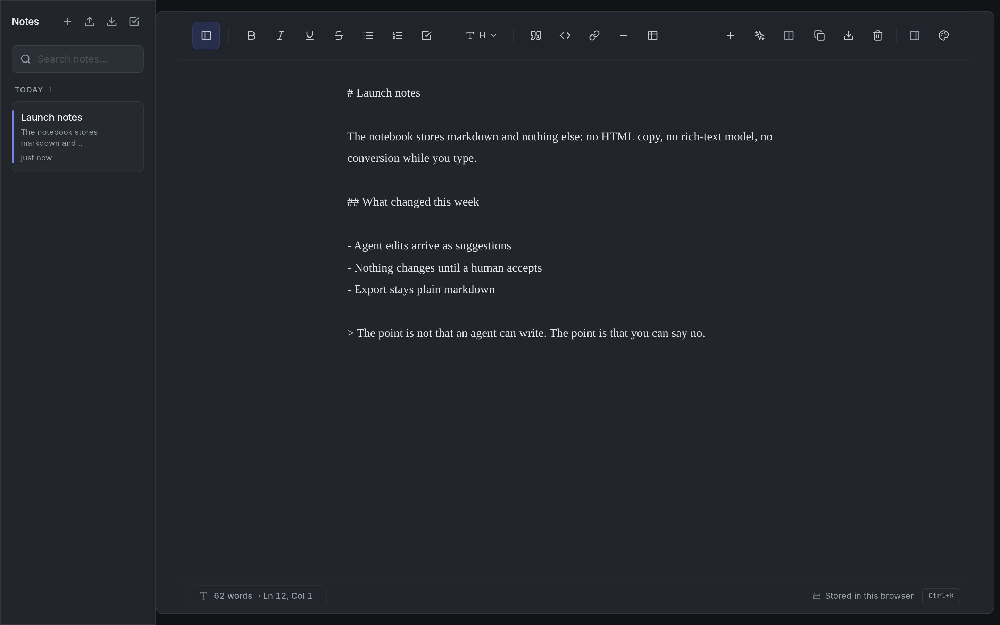
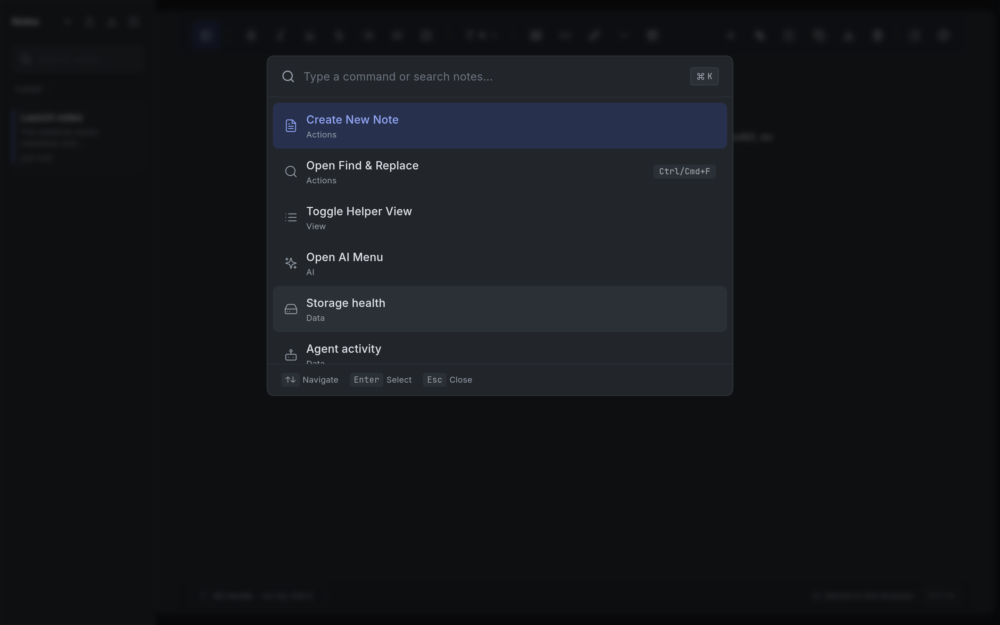
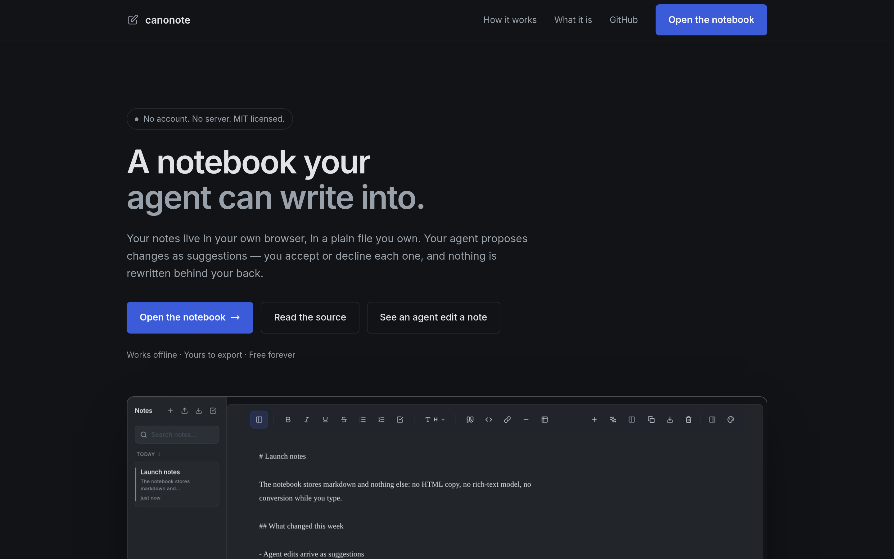

# canonote

**A calm, local-first markdown notebook that your agent can write into.**

Markdown is the only thing the app stores and the only thing the editor shows — no HTML copy of a
note, no rich-text node model, no conversion while you type. An agent works on exactly the text you
read, and every edit arrives under its own name — with the version before it one click away.

No account. No server. Open the app and start typing.

**Live:** [canonote.vercel.app](https://canonote.vercel.app) · **Source:** MIT, this repository.

## Screenshots

The notebook — a note open, the list on the left, a word count in the footer:



The command palette (`Cmd/Ctrl+K`) is the fastest way around the app:



The storage panel — where the notes live, how much space they take, when the last backup was:


The public front end, served at `/` (it is deliberately not the tool — the notebook is at `/app`):



## What it is

A notebook you can trust with plain text, built for people who already run an agent (Claude Code,
Cursor, MCP clients) and want one safe place for it to work.

- **One representation.** Markdown, everywhere — editor, storage, export, and any agent that reads
  the notebook.
- **An agent writes, and you see it.** Agent text lands in the note itself, marked with its author and
  a 3px rule down the left of every line it wrote, and the version before it is one click away. A
  change an agent wants to discuss arrives as a proposal on the note's thread instead — a proposal
  never touches the text until a person applies it.
- **Basic, reliable, quiet.** If a feature cannot be explained in one sentence, it does not ship.
- **Local-first.** The notebook is fully usable with no backend at all.

## What ships today

- A plain markdown editing surface — a textarea with reading-optimised typography, not a rich-text
  engine
- Local-first notebook: create, edit, search, pin, delete and reload, with no account and no server
- Note list with search, pinning, and per-note history (`history` tab, up to 50 snapshots)
- Formatting toolbar (bold, italic, headings, lists, quote, code, links) that edits markdown directly
- Export: Markdown, HTML, plain text and print/PDF per note; the whole notebook as a ZIP of markdown
  files with frontmatter
- Import: `.md` / `.markdown` / `.txt` files, or a ZIP the app itself wrote. Exporter frontmatter is
  round-tripped, and a note whose title already exists is skipped, so re-importing never duplicates
- Command palette, find & replace, split view, two themes (`midnight` and `sepia`), keyboard shortcuts
- Helper panel: table of contents, tags, note history, note navigation
- Storage panel (command palette → _Storage health_): where the notes live, how much space they take,
  when the last backup was — plus back up now, export everything, and restore the latest backup
- Notes in a folder you pick: one `.md` file per note in a directory of your choice (Chrome/Edge), with
  files you add there opening in the notebook and the notebook's own index kept in `.canonote.json`
- Rotating local backups: a whole-notebook snapshot written on demand and once a day on its own, the
  newest three kept in the browser. Restoring only adds notes the notebook no longer has
- A name you choose for your agent — shown on agent notes, note rows and connections;
  stored locally, defaulting to the neutral `Agent`
- Agent activity (command palette → _Agent activity_): the trail of what the agent created or edited,
  newest first, read from the server and scoped to your notes — and, in a notebook with no account, the
  honest statement that there is no trail to read
- **Someone else in the note, visible.** Every writer's caret is drawn on the character it names, with
  their name on it, and their selection tinted — a person in another tab of your account, or an agent
  that is working in the note right now. An agent's write appears in an open note in about a second,
  without a reload, wearing the author's band
- A journal that survives a killed tab: text typed but never committed comes back, listed with its
  title, the next time you open the notebook

## Where your notes live

By default the notebook reads and writes notes in your browser, in **IndexedDB** — that is why it works
with no account and no network. Web Storage (`localStorage`) is the fallback for a browser that has no
IndexedDB or refuses to open one, and a notebook left in Web Storage by an earlier session is moved
into the store the next time it opens.

You can also put the notebook on **a folder you pick** — Storage panel → _Use a folder for your notes_
(Chrome and Edge today; another browser simply never shows the option). Every note becomes one `.md`
file in that folder, holding exactly the markdown the editor shows, so the drive you already sync
carries your notes to your other machines and any other tool can read them. Files you drop into the
folder open in the notebook too; it keeps its own index in `.canonote.json` beside them, and the panel
can put the notebook back in the browser without moving or deleting a single file.

The storage layer sits behind a `NotebookStore` seam, so where notes physically live changes without
the app changing — three adapters are behind it (the folder, IndexedDB, Web Storage). Which one is the
default is **still open** (a folder on your disk that your own Drive/Dropbox syncs, a small hosted
Postgres, or a repo per user) and is recorded, unresolved, in [DECISIONS.md](./DECISIONS.md).

Import and export are the escape hatch and work today: your notes are never trapped in the app.

When the browser will not store anything — site data blocked, private browsing, a full quota — the app
says which of those it is and what to do about it, rather than claiming the note was saved.

Typing is journaled before it is committed, so a tab that is killed mid-save does not take the text
with it: the next time the notebook opens, it replays what was left behind and the note is listed with
its words. The store is also the seam's business, not the app's — the orphan scan and the storage panel
read through it rather than reaching into a particular browser API.

## Requirements

- Node.js `22.x` (pinned via `.nvmrc` and `package.json` `engines`)
- npm `>=9`

## Run it

```bash
npm install
npm run dev
```

`http://localhost:5173` is the public front end; the notebook is at
`http://localhost:5173/app` and opens straight into the editor. No client env is needed and there is
no sign-in — without a backend there is nothing to sign in to.

Useful scripts:

| Script                            | What it does                  |
| --------------------------------- | ----------------------------- |
| `npm run dev`                     | Vite dev server on `5173`     |
| `npm run build`                   | production build into `dist/` |
| `npm run check:bundle`            | bundle-size budget over `dist/` ([PERFORMANCE.md](./PERFORMANCE.md)) |
| `npm run preview`                 | serve the production build    |
| `npm run test:unit`               | Vitest unit suite (`src/**`)  |
| `npm run test:coverage`           | the same suite with coverage floors enforced |
| `npm run test`                    | Playwright end-to-end suite   |
| `npm run test:ui`                 | Playwright UI mode            |
| `npm run lint`                    | ESLint                        |
| `npm run format` / `format:check` | Prettier                      |
| `node scripts/audit-copy.mjs`     | the copy audit report — every string the app shows, held to the tone standard (`--all` prints the inventory) |

## Testing

Verified baseline on `main`:

- `npm run test:unit` — 72 files, 702 passed, 3 skipped
- `npm run test:coverage` — same suite, floors enforced for `src/utils`, `src/services`,
  `src/hooks` and `api/_lib`
- `npm test` — Playwright, the local notebook and the landing page (the hosted paths against a real
  backend have no automated coverage; see below)
- `npm run build` — passes
- `npm run check:bundle` — every bundle-size budget holds (largest chunk 98.3 kB, js + css 237.3 kB;
  budgets in [PERFORMANCE.md](./PERFORMANCE.md))
- `npm run lint` — 0 errors

Vitest collects `src/**` — unit tests live beside the source, including `src/api/` for the `api/_lib`
handlers, which are exercised with a mocked database client. The Playwright suite covers the local
notebook and the landing page only: most hosted paths (accounts, sync, agent tokens) have no
automated coverage there, so a green suite does not prove the live server routes. The exception is
the note thread, which has two checks that run against a real backend: `npm run check:thread-store`
asks the table to refuse what the contract says it must, and `npm run check:thread` drives an agent
and the deployed API through post → read → poll → decide.

## Architecture in 60 seconds

- `index.html` → `/` is the public front end; `app.html` → `/app` is the notebook. One Vite build,
  two HTML inputs, one `vercel.json` rewrite, and a dev middleware that mirrors that rewrite so the
  e2e suite exercises the same URLs production uses.
- The notebook is local-first: with no backend it runs as a **local notebook** and never shows a
  sign-in screen.
- After one visit the shell is cached by a service worker (`scripts/build-sw.mjs` writes it from the
  build), so `/app` opens with the network gone and the notes are where you left them. The cache is
  versioned by the build's content and never holds an `/api/` answer.
- The editor is a markdown textarea; `useNotes` and `useNotePersistence` own note state and the save
  path; storage goes through the `NotebookStore` seam in `src/services/storage-adapter.js`.
- `index.html` styles come from repo-root `site.css`; the app styles come from Tailwind
  (`index.css` + `tailwind.config.js`). A brand-token change lands in both in the same commit, or
  the two surfaces drift.
- The app asks a configured backend once and falls back to the local notebook if nothing answers:
  credentials in a build are not a backend.

## Hosted layer (optional, not part of the default)

The repository also carries an optional hosted layer — Postgres schema and migrations (`supabase/`),
serverless API routes (`api/`), accounts, canonical note sync, collaboration and delegated agent
tokens for `/api/agent/*`.

It is **not** part of the local-first default and this project does not run it for you: it needs
your own Postgres/Supabase project and server credentials. It is kept because a hosted version is a
candidate for where notes live, and because the agent API — the piece that makes agent edits
reviewable — belongs to it. The migrations are inert files; the API answers `503` without
credentials.

If you configure it, the client reads:

```bash
VITE_SUPABASE_URL=https://<project>.supabase.co
VITE_SUPABASE_ANON_KEY=<anon-key>
```

and the API routes read:

```bash
SUPABASE_URL=https://<project>.supabase.co
SUPABASE_SERVICE_KEY=<service-role-key>
```

Agent auth prefers delegated tokens from `POST /api/agent/connections`; env-configured static tokens
remain a legacy fallback. See [AGENT_API.md](./AGENT_API.md) for the quickstart with copy-paste
examples, [SUPABASE_SETUP.md](./SUPABASE_SETUP.md) and [API_CONTRACTS.md](./API_CONTRACTS.md) for the
long form.

## Removed in this rebuild

- TipTap/ProseMirror and its extensions (slash commands, tag and wikilink autocomplete popups)
- HTML↔markdown conversion on every keystroke
- The parallel HTML representation of each note

## Project structure

```text
index.html               the public front end, built to /
site.css                 its stylesheet (brand tokens, no Tailwind)
app.html                 the notebook, built to /app
src/
  components/            UI surfaces (PascalCase.jsx)
  context/               app context wiring (AppContext.jsx)
  hooks/                 stateful logic (useX.js)
  services/              storage seam, supabase, notes-api, openrouter
  api/                   unit tests for the api/_lib handlers
  utils/                 markdown, export, import, ids, time, dialog
api/                     optional hosted-layer route handlers
supabase/migrations/     schema history (001–014)
tests/                   Playwright end-to-end specs
```

## Contributing

See [CONTRIBUTING.md](./CONTRIBUTING.md). Security issues: [SECURITY.md](./SECURITY.md) — please do
not open a public issue for those. Changes since the last release live in
[CHANGELOG.md](./CHANGELOG.md).

## Deploying

`npm run build` produces a self-contained `dist/` that works on any static host: the notebook is
`dist/app/index.html` as well as `dist/app.html`, so `/app` resolves without a rewrite rule. Run
`npm run audit:artifact` after a build — it fails if any `href`/`src` in the built HTML points at a
file that is not in `dist/`, or if a route the product promises is missing.

Three ways to publish, in order of how little they depend on a human:

1. **Vercel CLI with the project owner's token.** `npm run deploy` (reads `VERCEL_TOKEN`, or a token
   file at `/srv/promi/.vercel-token`, `chmod 600`). Use this when a git push from another account
   lands as *"Deployment was blocked"*: on Hobby, only deployments authored by a team member promote,
   and a CLI deploy with the owner's token is authored by the owner.
2. **A Vercel Deploy Hook** — no account access, but it builds the same commit and may still hit the
   same author rule. Test it before relying on it.
3. **Any static host** — GitHub Pages (public repo), Cloudflare Pages, Netlify, nginx. `public/_redirects`
   carries the `/app` rewrite for hosts that read it; on hosts that do not, the emitted
   `app/index.html` covers the same route. For a **project site** served under a subpath
   (`user.github.io/<repo>/`), build with `npm run build -- --base=/<repo>/` — asset URLs and the
   page's own links are relative, so navigation stays inside the subpath instead of jumping to the
   domain root. Verified at `/notes-editor/`: `/app` → 301 → `/app/`, editor mounted, no failed
   requests.

## Licence

MIT — see [LICENSE](./LICENSE).

## Related docs

- [ROADMAP.md](./ROADMAP.md) — the slice plan to 1.0
- [AGENT_API.md](./AGENT_API.md) — how an agent gets a key and writes into a notebook
- [DECISIONS.md](./DECISIONS.md) — rebuild decisions, including the open storage question
- [PERFORMANCE.md](./PERFORMANCE.md) — the performance budget and the numbers behind it
- [BRAND.md](./BRAND.md) — the style canon for both surfaces
- [DESIGN-SYSTEM.md](./DESIGN-SYSTEM.md) — how the brand tokens are implemented
